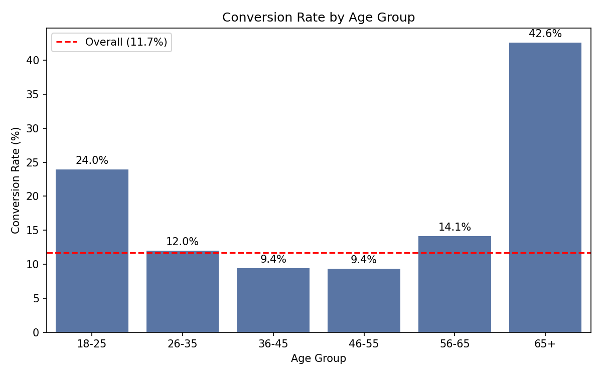
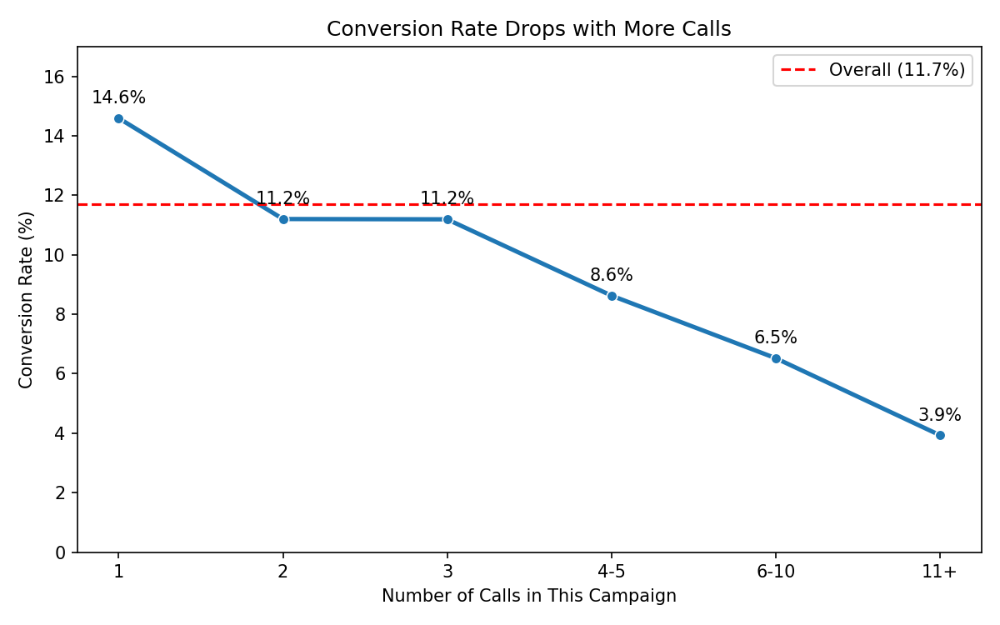
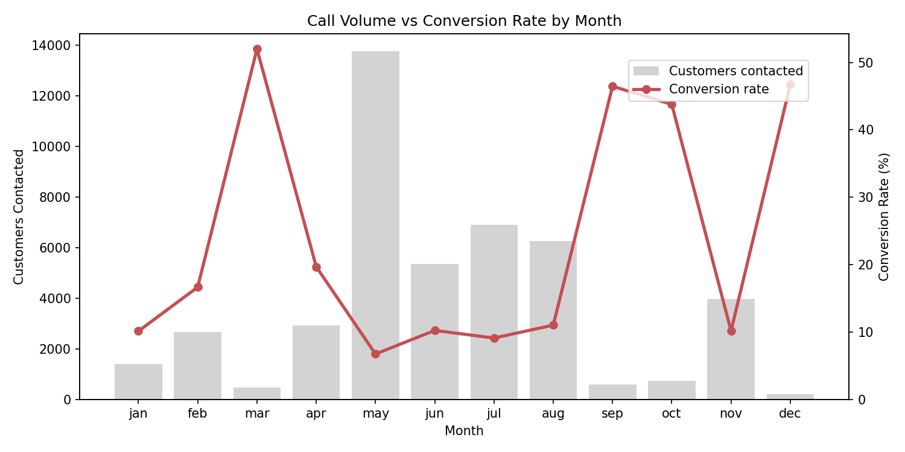

# Telemarketing Campaign Analysis: Who to Call, When, and How Often

## Overview
A Portuguese bank ran phone-based marketing campaigns to sell term deposits, but only **11.7%** of 45,211 contacted customers subscribed. This project analyzes the campaign data to identify which customers are most likely to convert and how the bank can make its calls more efficient.

**Tools:** Python (pandas, NumPy, matplotlib, seaborn), Google Colab
**Dataset:** [Bank Marketing – UCI Machine Learning Repository](https://archive.ics.uci.edu/dataset/222/bank+marketing)

## Business Questions
1. Which customer profiles are most likely to convert?
2. Do contact channel and timing affect conversion?
3. At what point do follow-up calls stop being worth the effort?
4. Are previously converted customers more likely to convert again?

## Key Findings

**1. Students, retirees, and older customers convert best.**
Students (28.7%) and retirees (22.8%) have the highest conversion rates, and customers aged 65+ reach 42.6%. Blue-collar workers, the largest group contacted, convert the least (7.3%).

**2. More calls bring diminishing returns.**
Conversion drops from 14.6% on the first call to 3.9% after 11+ calls. Capping follow-ups at 3 calls would free up **29.5% of call volume** while putting at most **13.4% of conversions** at risk.

**3. Call volume does not equal results.**
May had the highest call volume (~30% of all calls) but the lowest conversion rate, while low-volume months converted at 45–50%.

**4. Past success is the strongest signal.**
Customers who subscribed in a previous campaign converted at **64.7%**, about 7x higher than first-time contacts (9.2%).

## Recommendations
- **Call warm leads first:** prioritize customers with a successful previous campaign outcome.
- **Focus on high-propensity segments:** students, retirees, older customers, and higher-balance customers.
- **Cap follow-ups at 3 calls** and reallocate saved agent time to new prospects.
- **Avoid untargeted mass-calling periods** and spread campaigns across the year.
- **Always record the contact channel** to enable accurate performance tracking.

## Project Workflow
1. Data loading and overview
2. Data cleaning (handling missing values, recoding target variable)
3. Feature engineering (age, balance, and call-count groups)
4. Customer profile analysis
5. Channel, timing, and previous campaign analysis
6. Impact estimation of a follow-up cap
7. Insights, recommendations, and limitations

## Limitations
- Call `duration` was excluded from targeting analysis since it is only known after a call ends.
- Findings show correlation, not causation.
- High conversion in low-volume months may reflect selective targeting rather than seasonality.

## Author
**M Fariel Fahriza Tielung**
[LinkedIn](https://www.linkedin.com/in/m-fariel-fahriza-tielung-8250522a4) · [GitHub](https://github.com/farielfahriza)
